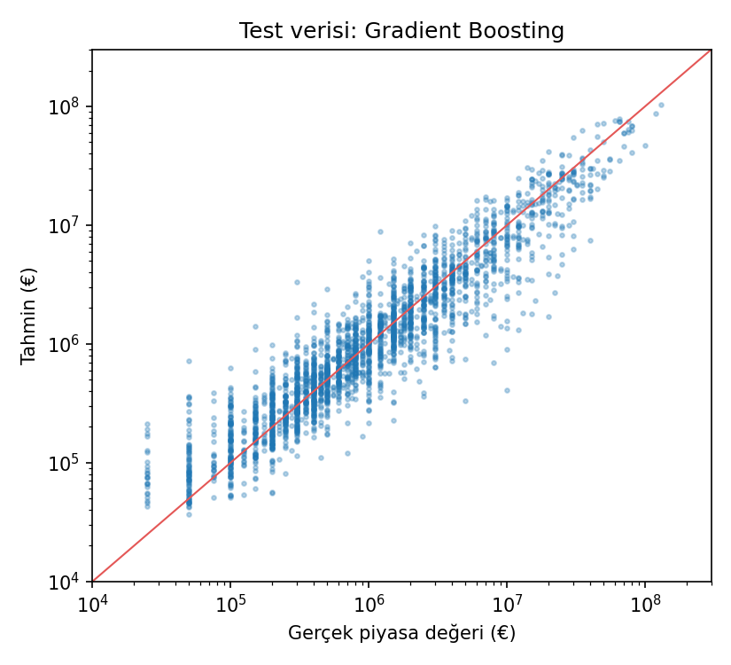
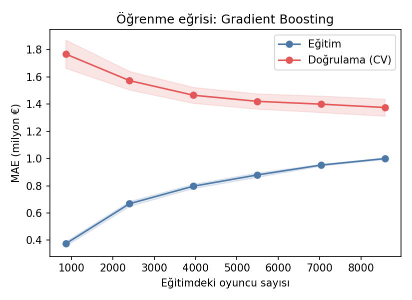
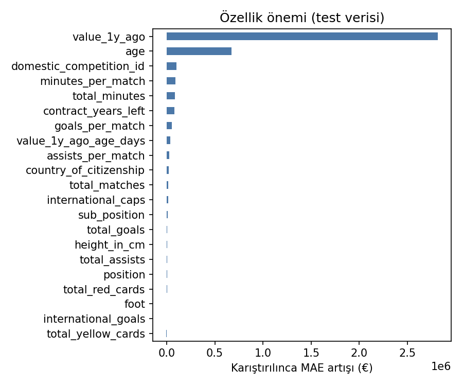
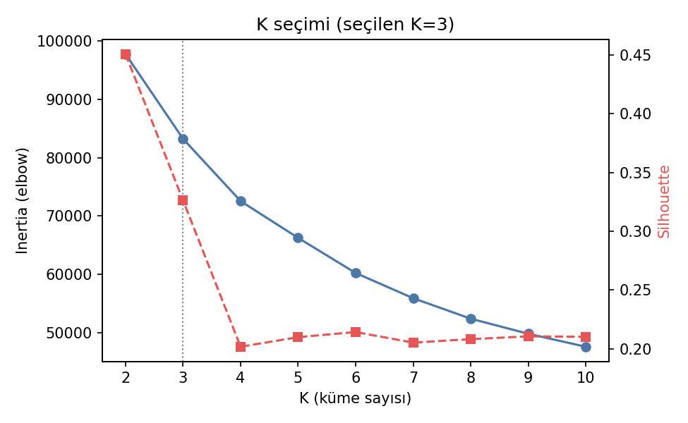
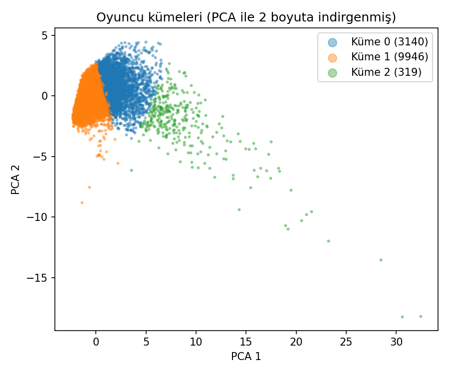

# Transfermarkt ML Project

Transfermarkt verisiyle futbolcuların piyasa değerini tahmin eden bir **denetimli (supervised)** model ve oyuncuları özelliklerine göre gruplara ayıran bir **denetimsiz (unsupervised)** model.

**Sonuç:**
- **Piyasa değeri tahmini (Gradient Boosting):** Test verisindeki oyuncuların yarısında hata **235 bin €'nun** altında kaldı. Oyuncuların **%71'inde** tahmin, gerçek değerin ±%50'si içinde (R² = 0,83).
- **Oyuncu kümeleme (K-Means, K=3):** Kümeleme piyasa değerini hiç kullanmadı. Buna rağmen üç kümenin medyan değerleri belirgin biçimde ayrıştı: 0,7M €, 1,4M € ve 3,5M €.

---

## 1. Veri seti

Kaynak: [Transfermarkt veri seti (Kaggle, davidcariboo/player-scores)](https://www.kaggle.com/datasets/davidcariboo/player-scores). Kullanılan tablolar: `players.csv`, `appearances.csv` ve `clubs.csv`. Maç kayıtları 2012-07 ile 2026-06 arasını kapsıyor.

| Adım | Oyuncu |
|---|---:|
| Ham `players.csv` | 50.149 |
| Aktif oyuncular (`last_season >= 2023`) | 30.459 |
| Maç kaydı olanlar | 15.116 |
| Piyasa değeri bilinenler | 14.110 |
| Yaş, mevki ve lig bilgisi geçerli olanlar | **13.405** |

**Hedef değişken:** `market_value_in_eur`. Dağılım çok çarpık: medyan 0,8M €, en yüksek 200M €.

## 2. Özellikler

| Grup | Özellikler |
|---|---|
| Kişisel | `age`, `height_in_cm`, `foot`, `country_of_citizenship` |
| Mevki ve lig | `position`, `sub_position`, `domestic_competition_id` |
| Milli takım | `international_caps`, `international_goals` |
| Kariyer toplamları (`appearances.csv`) | `total_matches`, `total_goals`, `total_assists`, `total_minutes`, `total_yellow_cards`, `total_red_cards` |
| Oranlar | `goals_per_match`, `assists_per_match`, `minutes_per_match` |
| **Geçmiş değer** (`player_valuations.csv`) | `value_1y_ago`: hedef değerden **en az 1 yıl önceki** son piyasa değeri. `value_1y_ago_age_days`: o değerin ne kadar eski olduğu |
| **Sözleşme** | `contract_years_left`: sözleşmenin bitmesine kalan yıl |

`highest_market_value_in_eur` bilerek kullanılmadı. Oyuncunun bugünkü değerini de içerebildiği için kullanılsaydı model "kopya çekmiş" olurdu. Aynı sebeple geçmiş değer olarak sadece en az bir yıl önceki değerleme alındı (bkz. bölüm 4).

---

## 3. Supervised: piyasa değeri tahmini

### Yöntem
1. **%80 eğitim / %20 test ayrımı.** Test verisi en sona kadar hiç kullanılmadı.
2. **Ön işleme pipeline'ın içinde:** Eksik boy medyanla dolduruluyor. 100'den az oyuncusu olan ülke ve ligler tek bir "diğer" sütununda toplanıyor. Ardından one-hot encoding yapılıyor. Bu adımların hepsi sadece eğitim verisinden öğreniliyor, böylece test verisinden bilgi sızmıyor.
3. **Log hedef:** Model `log(1 + değer)` üzerinde eğitiliyor, tahminler tekrar €'ya çevriliyor. Bu sayede 200M €'luk birkaç yıldız, 500 bin €'luk binlerce oyuncunun hatasını bastırmıyor.
4. **Model seçimi:** Üç model 5 katlı çapraz doğrulama ve ayar aramasıyla karşılaştırıldı. Seçim ölçütü € cinsinden ortalama mutlak hata (MAE).

### Model karşılaştırması (5 katlı CV, eğitim verisi)

| Model | En iyi ayarlar | CV MAE |
|---|---|---:|
| Ridge Regression (baseline) | alpha=100 | 1.564.315 € ± 133.271 |
| Random Forest | min_samples_leaf=1, max_features=1.0 | 1.471.811 € ± 48.663 |
| **Gradient Boosting** ✅ | learning_rate=0.03, max_leaf_nodes=31 | **1.376.172 € ± 62.425** |

### Test sonuçları (2.681 oyuncu)

Üç sürüm de aynı test oyuncularında ölçüldü:

| Ölçüt | Anlamı | İlk yaklaşım (RF, log yok) | Ek özelliklerden önce (GB, log) | **Final model** |
|---|---|---:|---:|---:|
| Medyan mutlak hata | Oyuncuların yarısında hata bundan küçük | 636.375 € | 372.353 € | **234.919 €** |
| Medyan yüzde hata | Tipik oyuncuda hata, değerinin yüzde kaçı? | %65,3 | %47,4 | **%30,5** |
| ±%50 içinde | Tahmini gerçeğe yeterince yakın olanlar | %39,8 | %53,6 | **%70,9** |
| 2 kat veya daha fazla yanlış | Çok kötü tahminlerin oranı | %46,7 | %35,7 | **%18,1** |
| MAE | Ortalama mutlak hata | 2.119.818 € | 1.921.132 € | **1.367.863 €** |
| MSE | Ortalama kare hata | 2,57·10¹³ €² | 2,83·10¹³ €² | **1,44·10¹³ €²** |
| RMSE | MSE'nin karekökü | 5.068.387 € | 5.322.400 € | **3.795.777 €** |
| R² | Varyansın ne kadarı açıklanıyor? | 0,703 | 0,672 | **0,833** |

**Basitçe:** 10 oyuncudan ilk yaklaşım 4'ünü, ek özelliklerden önceki model 5'ini, final model **7'sini** gerçek değerin ±%50'si içinde tahmin ediyor.

**Log dönüşümünde R² neden düştü?** R², büyük hataların karesine baktığı için birkaç pahalı yıldızın etkisine çok duyarlı. Log dönüşümü modeli bütün oyuncular için dengeli hale getiriyor. Bu yüzden ilk iki sütun arasında R² biraz düşerken tipik oyuncu için hata %41 azaldı. Proje ilk geliştirilirken log dönüşümü sadece R²'ye bakılarak geri alınmıştı. Diğer ölçütler kontrol edilince bu kararın yanlış olduğu görüldü.



### Öğrenme eğrisi



Doğrulama hatası (MAE) eğitim verisi arttıkça 1,77M €'dan 1,38M €'ya düşüyor ve hâlâ hafifçe iniyor: daha fazla oyuncu verisi işe yarar. Eğitim ve doğrulama hatası arasındaki açıklık, modelin eğitim verisini kısmen ezberlediğini gösteriyor.

### Hangi özellikler önemli?

Permutation importance yöntemiyle ölçüldü: bir özellik karıştırıldığında hatanın ne kadar arttığına bakılıyor. Açık ara en önemli özellik **bir yıl önceki değer**. Onu **yaş**, **lig** ve oynanan dakika izliyor. Sözleşme süresi de ilk altıya giriyor. Ayak tercihi, boy ve kart sayıları neredeyse hiç katkı vermiyor.



---

## 4. Ek geliştirme: geçmiş değer ve sözleşme süresi

İlk modelin en büyük hataları, kariyer istatistikleri güçlü ama değeri düşmüş oyuncularda (ör. Sebastian Szymański: gerçek 12M €, tahmin 40M €) ve verisi eksik oyuncularda (ör. Mohamed Camara: gerçek 20M €, tahmin 2M €) çıkıyordu. Model oyuncunun "piyasadaki itibarını" bilmiyordu. Bu yüzden iki özellik denendi:

1. **Bir yıl önceki piyasa değeri** (`player_valuations.csv`)
2. **Sözleşmenin bitmesine kalan süre** (`players.csv`)

**Veri sızıntısını önlemek için:** Hedef, oyuncunun en son değerlemesi. Geçmiş değer olarak bu tarihten **en az 365 gün önceki** son değerleme alındı. Daha yakın tarihli bir değer kullanılsaydı model cevabın neredeyse aynısını görmüş olurdu. Sözleşme süresi de aynı tarihe göre hesaplandı.

Üç sürüm aynı test oyuncularında, aynı model ailesi (Gradient Boosting) ve aynı ayar aramasıyla karşılaştırıldı:

| Sürüm | Medyan yüzde hata | ±%50 içinde | 2 kat+ yanlış | R² |
|---|---:|---:|---:|---:|
| Ek özellik yok | %47,4 | %53,6 | %36 | 0,672 |
| + bir yıl önceki değer | %31,6 | %69,9 | %19 | 0,830 |
| **+ bir yıl önceki değer + sözleşme** ✅ | **%30,5** | **%70,9** | **%18** | **0,833** |

| Örnek oyuncu | Gerçek | Ek özellik yok | Final model |
|---|---:|---:|---:|
| Sebastian Szymański | 12,0M € | 40,4M € ❌ | 18,9M € |
| Mohamed Camara | 20,0M € | 2,3M € ❌ | 27,2M € ✓ |
| David Raya* | 30,0M € | 8,1M € ❌ | 21,5M € ✓ |

\* Szymański ve Camara test verisinde, Raya ise eğitim verisinde (yani model onu eğitimde görmüştü).

**Karar:** Asıl iyileşmeyi bir yıl önceki değer getiriyor. Sözleşme süresinin katkısı küçük ama tutarlı ve modele mantıklı, açıklanabilir yeni bir bilgi ekliyor. Bu yüzden ikisi birlikte final modele alındı.

---

## 5. Unsupervised: oyuncu kümeleme

### Yöntem
- **Özellikler:** Yaş, boy, milli maç/gol, kariyer maç/gol/asist/dakika, maç başına gol ve dakika. Kategorik sütunlar mesafe hesabını bozacağı için kullanılmadı.
- Özellikler `StandardScaler` ile ölçeklendi. K-Means mesafeye dayandığı için bu adım şart.
- **K seçimi:** K=2…10 arası denendi ve her biri için silhouette skoru hesaplandı. En yüksek skor K=2'de (0,451), ama iki küme yalnızca "çok oynayan / az oynayan" ayrımı veriyor. Bu yüzden K≥3 arasında en yüksek skora sahip olan **K=3** (0,326) seçildi. K=4 ve üzerinde skor 0,20–0,21'e düşüyor. Önceki sürümde göz kararı seçilen K=5'in skoru 0,210'du.



### Kümeler

| Küme | Oyuncu | Ort. yaş | Ort. maç | Ort. gol | Ort. milli maç | Medyan değer | Yorum |
|---|---:|---:|---:|---:|---:|---:|---|
| 1 | 9.946 | 25,9 | 38 | 2,5 | 5 | 0,7M € | Genç / az deneyimli |
| 0 | 3.140 | 31,9 | 217 | 19 | 18 | 1,4M € | Deneyimli, düzenli oynayan |
| 2 | 319 | 33,1 | 386 | 103 | 70 | 3,5M € | Kariyerli yıldızlar ve golcüler, milli takım oyuncuları |



**Kümeleme ölçütleri (K=3):** Silhouette 0,326 (−1…1, büyük iyi) · Davies-Bouldin 1,32 (küçük iyi) · Calinski-Harabasz 4.092 (büyük iyi).

**Yorum:** Kümeleme piyasa değerini görmedi, ama değer kümeler arasında sıralı olarak artıyor. Yani bulunan gruplar anlamlı. Yine de silhouette skoru 0,33 seviyesinde, kümeler net biçimde ayrışmıyor. Oyuncular kesin gruplardan çok "az deneyimliden çok deneyimliye" uzanan bir süreklilik üzerinde dağılıyor. Bu durum PCA grafiğinde de görülüyor.

---

## 6. Geliştirme sürecinde düzeltilenler

| Önceki durum | Sorun | Düzeltme |
|---|---|---|
| `python src/...` komutu proje klasöründen çalışmıyordu | Kod `../data` yolunu kullanıyordu | Yollar `src/paths.py` dosyasında, proje köküne göre tanımlandı |
| Yaş "bugün"e göre hesaplanıyordu | Her çalıştırmada sonuçlar değişiyordu | Yaş, veri setindeki son maç tarihine (2026-06-28) göre sabitlendi |
| Medyanla doldurma, ülke gruplama ve one-hot işlemleri bölmeden önce tüm veride yapılıyordu | Test verisi ön işlemeyi etkiliyordu (veri sızıntısı) | Bu adımlar pipeline'a taşındı ve sadece eğitim verisinden öğreniliyor |
| Log dönüşümü sadece R²'ye bakılarak geri alınmıştı | Tipik oyuncu için hata daha büyük kalıyordu | Log hedef geri getirildi, tüm ölçütler birlikte raporlanıyor |
| Tek bölme, ayar araması yoktu | Model seçimi şansa bağlıydı | 5 katlı CV ve 3 model karşılaştırması eklendi |
| K=5 göz kararı seçilmişti | Seçim gerekçesiz kalıyordu | K, silhouette skoruna göre belirli bir kuralla seçiliyor |
| Model kaydedilmiyordu, sonuçlar sadece terminale yazılıyordu | Tekrar üretilebilir değildi | Modeller `models/`, sonuçlar ve grafikler `reports/` klasörüne kaydediliyor |
| Model sadece kariyer istatistiklerine bakıyordu | Değeri düşmüş veya verisi eksik oyuncularda büyük hatalar | Bir yıl önceki değer ve sözleşme süresi eklendi (bölüm 4) |

## Teslim dosyaları (Assignment 1)

| Dosya | İçerik |
|---|---|
| [docs/2_Futbol_Deger_Gradient_Boosting.pptx](docs/2_Futbol_Deger_Gradient_Boosting.pptx) | Sunum: Gradient Boosting ile piyasa değeri tahmini |
| [docs/3_Futbol_Kumeleme_KMeans.pptx](docs/3_Futbol_Kumeleme_KMeans.pptx) | Sunum: K-Means ile oyuncu segmentasyonu |
| [docs/Proje_Raporu.pdf](docs/Proje_Raporu.pdf) | Süreci anlatan proje raporu (SMS Spam + Futbol projeleri) |

## 7. Kurulum ve çalıştırma

Python 3.10 veya üzeri gerekir.

```bash
git clone https://github.com/yagizefecsoy/transfermarkt-ml-project.git
cd transfermarkt-ml-project
python -m venv .venv
.\.venv\Scripts\Activate.ps1        # Windows PowerShell
# source .venv/bin/activate         # macOS / Linux
pip install -r requirements.txt
```

Temizlenmiş veri (`data/processed/players_cleaned.csv`) repoda bulunuyor. Doğrudan eğitime geçebilirsiniz:

```bash
python src/train_model.py       # supervised (~2-3 dk)
python src/cluster_players.py   # unsupervised (~1 dk)
python src/predict.py           # kendi girdiğin oyuncu için değer tahmini + küme
```

Veri hazırlığını sıfırdan çalıştırmak için önce Kaggle'dan veri setini indirip CSV dosyalarını `data/raw/` klasörüne koyun:

```bash
python src/explore_data.py      # ham verilere ilk bakış
python src/prepare_data.py      # temizleme -> data/processed/players_cleaned.csv
```

Tüm rastgelelikler `random_state=42` ile sabitlendi.

## 8. Proje yapısı

```
transfermarkt-ml-project/
├── data/
│   ├── raw/                     # Kaggle CSV'leri (repoda yok, ~900 MB)
│   └── processed/players_cleaned.csv
├── src/
│   ├── paths.py                 # klasör yolları, sabitler
│   ├── explore_data.py          # ham verilere ilk bakış
│   ├── prepare_data.py          # birleştirme, temizleme, özellik çıkarma
│   ├── train_model.py           # supervised: model karşılaştırma, test, kaydetme
│   ├── cluster_players.py       # unsupervised: K seçimi, kümeleme
│   └── predict.py               # etkileşimli tahmin (kaydedilmiş modellerle)
├── models/                      # market_value_model.joblib, player_clusters.joblib
├── reports/
│   ├── metrics_supervised.json
│   ├── metrics_clustering.json
│   ├── cluster_summary.csv
│   └── figures/
└── requirements.txt
```

## 9. Sınırlar

- **Piyasa değeri insan değerlendirmesidir.** Transfermarkt değerleri; sakatlık, menajer ve medya ilgisi gibi bu veride olmayan etkenleri de yansıtır. Bu yüzden mükemmel bir tahmin beklenmemeli.
- **Model geçmiş değere çok dayanıyor.** Bir yılda değeri birden yükselen genç yetenekleri (ör. Rodrigo Mendoza: gerçek 20M €, tahmin 8M €) yakalayamıyor. Bir yıl önceki değeri olmayan oyuncularda (%6) tahmin daha zayıf.
- **Kariyer toplamları kullanıldı.** Son sezon formu ayrıca ölçülmedi.
- **Eksik maç verisi.** `appearances.csv` her ligi kapsamıyor. Maç kaydı olmayan aktif oyuncular modelden çıkarıldı.
- **Kümeler zayıf ayrışıyor.** Silhouette skoru 0,33. Kümeler kesin oyuncu tiplerini değil, deneyim ekseni üzerindeki kabaca bölgeleri temsil ediyor.
